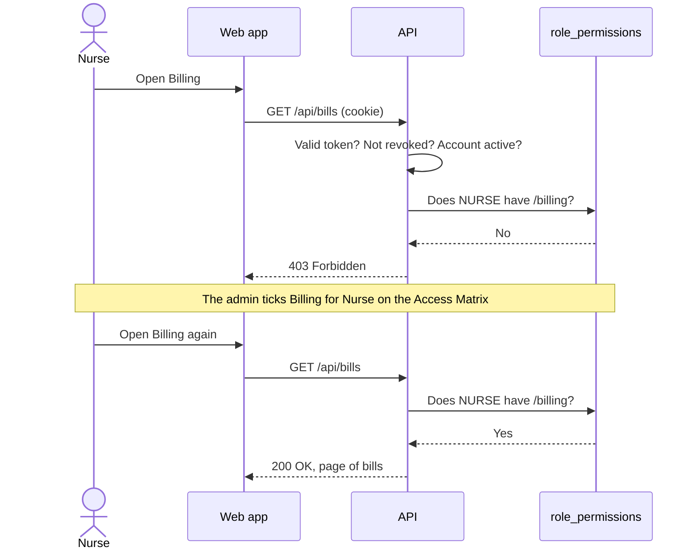
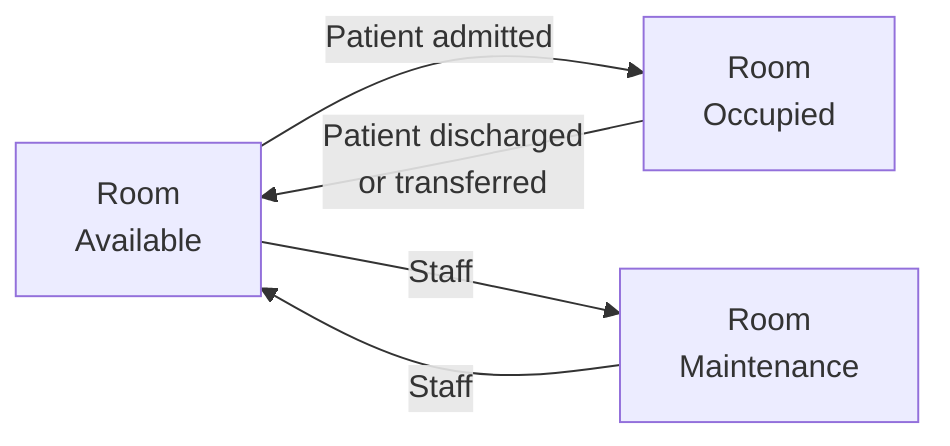
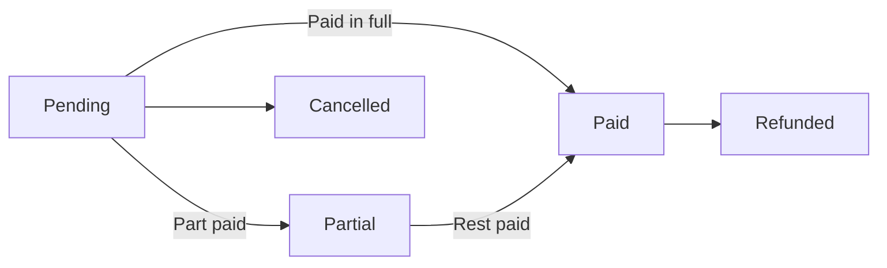
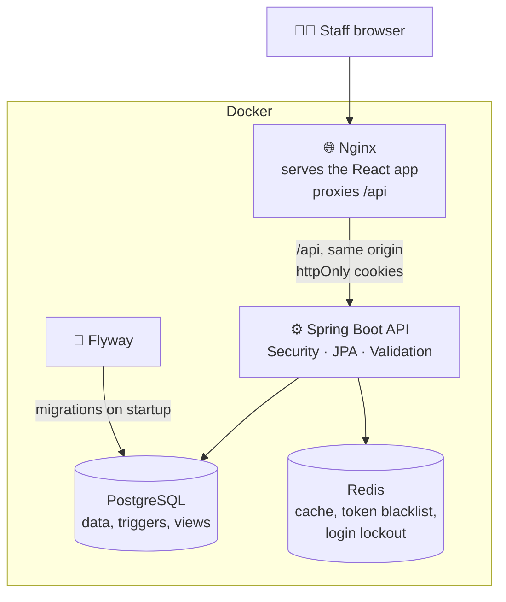

<div align="center">

# Hospital Management System

**One dashboard to run a hospital: patients, appointments, admissions, lab, pharmacy, billing, and payroll, with each role seeing only what it needs.**


</div>

---

## What is this?

A full hospital back office, built around the people who use it every day:

- **Receptionists** register patients, book appointments, admit patients to rooms, and take payments.
- **Doctors and nurses** see their patients, appointments, admissions, lab tests, and the pharmacy.
- **Lab technicians** move tests from ordered to completed and record the results.
- **Pharmacists** keep the medication catalog and restock items running low.
- **HR** manages employees and runs monthly payroll.
- **Admins** see everything, manage user accounts, and decide which role can open which module.

**What makes it different:** permissions live in the database and are enforced by the API, not just hidden in the menu. An admin can change who sees what from a screen, and the change applies on the next request. An occupied room can't take a new admission, a doctor can't be booked twice at the same time, and a payment can never be more than what's still owed on the bill.

## Contents

| Start here | How it works | Reference |
| --- | --- | --- |
| [What it does](#what-it-does) | [Who can open what](#who-can-open-what) | [Data model](#data-model) |
| [Who uses it](#who-uses-it) | [Admissions and rooms](#admissions-and-rooms) | [API endpoints](#api-endpoints) |
| [Run it locally](#run-it-locally) | [Bills and payments](#bills-and-payments) | [Environment variables](#environment-variables) |
| [Demo accounts](#demo-accounts) | [How it's built](#how-its-built) · [Security](#security) | [Project structure](#project-structure) |

---

## What it does

| Area | What you can do |
| --- | --- |
| 👤 **Patients** | Register patients with date of birth, gender, contact details, address, and blood group. Search and page through the list. |
| 🩺 **Doctors and departments** | Keep doctors with their specialization, license number, and department. Departments group the doctors. |
| 📅 **Appointments** | Book a patient with a doctor, see today's schedule, and mark each visit confirmed, completed, cancelled, or no-show. Double-booking a doctor at the same time is refused. |
| 🛏️ **Admissions and rooms** | Admit a patient to an available room and discharge them later. Rooms are general, private, ICU, emergency, OT, or maternity, and their status updates on its own. |
| 🔬 **Lab** | Order tests, move them through collected, in progress, and completed, and record one result per test. |
| 💊 **Pharmacy** | Keep the medication catalog with prices and reorder levels, see what's running low, and restock. |
| 💳 **Billing** | Create itemized bills for a patient and record full or partial payments. The bill's status follows the money. |
| 👥 **Employees and payroll** | Keep staff records and generate one payroll per employee per month, then mark it paid. |
| 📊 **Dashboard and reports** | Totals for patients, today's appointments, current admissions, free rooms, pending lab tests, low stock, unpaid bills, and this month's revenue, with charts. |
| 🔐 **Accounts** | Admins create users, assign roles, turn accounts on or off, and link a login to its doctor or employee record. |
| 🧩 **Access matrix** | A grid of roles × modules that admins edit on screen. The API checks it on every request. |

## Who uses it

Default access, as seeded. Admins change it on the **Access Matrix** page. `ADMIN` always keeps full access.

| | 👑 Admin | 🩺 Doctor | 💉 Nurse | 🗂️ Reception | 🔬 Lab | 💊 Pharmacy | 👥 HR |
| --- | :---: | :---: | :---: | :---: | :---: | :---: | :---: |
| Dashboard | ✅ | ✅ | ✅ | ✅ | ✅ | ✅ | ✅ |
| Patients | ✅ | ✅ | ✅ | ✅ | ✅ | ✅ | |
| Appointments | ✅ | ✅ | ✅ | ✅ | | | |
| Doctors, departments | ✅ | ✅ | ✅ | ✅ | | | ✅ |
| Admissions, rooms | ✅ | ✅ | ✅ | ✅ | | | |
| Lab | ✅ | ✅ | ✅ | | ✅ | | |
| Pharmacy | ✅ | ✅ | ✅ | | | ✅ | |
| Billing | ✅ | | | ✅ | | | |
| Employees, payroll | ✅ | | | | | | ✅ |
| Reports | ✅ | ✅ | | | | | ✅ |
| Users, access matrix | ✅ | | | | | | |

Some actions are tighter than the module: only admins add, edit, or delete doctors and departments, only admins delete patients, and only admin, reception, nurses, and doctors register or edit patients.

---

## Who can open what

Every API call goes through the same check, so hiding a menu item is never the only protection.



- Each `/api/<module>` request is mapped to a module and checked against the `role_permissions` table.
- `ADMIN` always passes. User management and the access matrix itself are admin-only no matter what the table says.
- The web app loads the same matrix to build its menu, so staff only see the modules they can open.

## Admissions and rooms



- A patient can only be admitted to a room that's **available**. Otherwise the request is refused with the room number.
- Admitting marks the room occupied, and discharging frees it. A database trigger does the same thing, so the room stays right even if a row is changed outside the app.
- Discharging twice is refused, and the discharge time is recorded.
- The Rooms page shows how many rooms are available, occupied, and in maintenance.

## Bills and payments



- A bill is a list of items, each with a quantity and unit price. The total recalculates on its own whenever an item is added, changed, or removed.
- Each payment must be positive and can't be more than the outstanding balance. Paid, cancelled, and refunded bills take no more payments.
- The status moves between pending, partial, and paid by itself as money comes in.
- Payroll works the same way: one record per employee per month (`YYYY-MM`), a positive base salary, and it can only be marked paid once.

---

## How it's built



| Layer | Technology |
| --- | --- |
| Web | React 18, TypeScript 5.5, Vite 5, React Router 6, TanStack Query, Axios, Zustand, React Hook Form + Zod, Tailwind CSS, Headless UI, Recharts, Lucide |
| API | Java 21, Spring Boot 3.4 (Web, Data JPA, Security, Validation, Actuator), JWT (jjwt), MapStruct, Lombok |
| Data | PostgreSQL 16 with Flyway migrations, Redis 7 |
| Infrastructure | Docker Compose, Nginx |
| Tooling | Maven, ESLint; tests with JUnit and Spring Boot Test |

**Business rules live in the service layer**, and controllers only translate HTTP. The database backs up the important ones with triggers and check constraints (bill totals, bill status, room status, pharmacy stock, non-negative amounts, payroll month format).

**Speed:** frequent reads are cached in Redis with short lifetimes (dashboard 2 minutes, patients 10, doctors 30, departments 1 hour) and cleared when the data changes. Lists are paginated, 20 rows by default.

## Security

| Protection | How it works |
| --- | --- |
| 🔑 Passwords | Stored only as bcrypt hashes, never sent back in a response or written to the cache |
| 🍪 Sign-in | Access and refresh tokens in **httpOnly, `SameSite=Strict` cookies**. Tokens never appear in response bodies or browser storage |
| 🔁 Refresh | Refreshing rotates both tokens, and each refresh token works only once |
| 🚪 Sign-out | Revoked tokens are blacklisted in Redis until they expire. Deactivating a user cuts off their access right away |
| 🧩 Token types | Access and refresh tokens are typed, so one can't be used in place of the other |
| 🚦 Lockout | 5 wrong passwords lock that username for 15 minutes (counter kept in Redis) |
| 🧑‍⚖️ Permissions | Checked by the API on every request against the access matrix |
| 🛡️ Admin safeguards | An admin can't deactivate or delete their own account, or remove their own `ADMIN` role |
| 🪖 Headers | Nginx sends a Content Security Policy, `X-Frame-Options: DENY`, `nosniff`, a Referrer-Policy and a Permissions-Policy |
| 🔒 HTTPS | Cookies get the `Secure` flag on their own when the app is served over HTTPS (the API trusts `X-Forwarded-Proto`) |
| 🔐 Secrets | Docker won't start without `JWT_SECRET`. There is no built-in default |
| 🐳 Network | PostgreSQL and Redis are not published to the host; only the API and the website are |

---

## Run it locally

### Option 1: Docker (easiest)

**You need:** Docker and Docker Compose.

```bash
git clone https://github.com/sahc1987/Hospital-App.git
cd Hospital-App
cp .env.example .env
# Set JWT_SECRET (required): openssl rand -base64 48
# Replace POSTGRES_PASSWORD and REDIS_PASSWORD with your own values
docker compose up --build
```

| Service | Address |
| --- | --- |
| 🖥️ Website | http://localhost:3000 |
| ⚙️ API | http://localhost:8080 (also at http://localhost:3000/api) |

The database tables and demo data are created on first start by Flyway. Sign in with one of the [demo accounts](#demo-accounts).

> `POSTGRES_PASSWORD` only takes effect when the database volume is first created. To change it later, change it inside Postgres, or recreate the `postgres_data` volume (this deletes all data).
>
> To reach PostgreSQL from your machine (for example with `psql`), add a local-only port such as `"127.0.0.1:5433:5432"` to the `postgres` service.

### Option 2: Run each part yourself

<details>
<summary><b>Backend and web commands</b></summary>

**Backend** (needs JDK 21+, Maven, and PostgreSQL and Redis on `localhost:5432` / `localhost:6379`)

```bash
cd backend
export JWT_SECRET="$(openssl rand -base64 48)"   # required
mvn spring-boot:run                               # http://localhost:8080
```

Point it at other hosts with the `SPRING_DATASOURCE_*` and `SPRING_DATA_REDIS_*` variables. If PostgreSQL and Redis run in Docker, publish their ports first (see above).

**Web**

```bash
cd frontend
npm install
npm run dev       # http://localhost:3000, proxies /api to the backend
```

Stop the Docker `frontend` container first, because it also uses port 3000.

| Script | Does |
| --- | --- |
| `npm run dev` | Dev server with hot reload |
| `npm run build` | Type-check and build for production |
| `npm run preview` | Preview the production build |
| `npm run lint` | Run ESLint |

</details>

### Run the tests

```bash
cd backend && mvn test
```

### Demo accounts

The seed data creates these accounts, all with the password `Admin@123`:

| Username | Role |
| --- | --- |
| `admin` | ADMIN |
| `dr_smith`, `dr_patel`, `dr_chen`, `dr_garcia`, `dr_johnson` | DOCTOR |
| `nurse_ali`, `nurse_kim` | NURSE |
| `recept_anna` | RECEPTIONIST |
| `lab_mike` | LAB_TECH |
| `pharma_sara` | PHARMACIST |
| `hr_david` | HR |

> ⚠️ Change or disable every demo account before any real deployment.

---

## Reference

<details>
<summary><b>Data model</b></summary>

### Data model

| Group | Table | Holds |
| --- | --- | --- |
| People | `users` | Login, role, active flag |
| | `role_permissions` | Which role can open which module |
| Clinical | `departments` | Name and description |
| | `doctors` | Specialization, license number, department, linked user |
| | `patients` | Date of birth, gender, contact details, blood group |
| | `appointments` | Patient, doctor, date and time, status |
| | `rooms` | Number, type, floor, daily rate, status |
| | `admissions` | Patient, doctor, room, diagnosis, admit and discharge dates |
| | `lab_tests` / `lab_results` | Ordered tests and their result |
| Pharmacy | `pharmacy_items` / `pharmacy_stock` | Catalog, reorder level, and stock batches |
| Money | `bills` / `bill_items` | Itemized bills, discount, amount paid |
| Staff | `employees` / `payroll` | Staff records and monthly pay |
| Schema only | `prescriptions`, `prescription_items`, `insurance_providers`, `insurance_claims` | Tables are in place; there are no screens or endpoints for them yet |

**Appointment status:** `SCHEDULED`, `CONFIRMED`, `COMPLETED`, `CANCELLED`, `NO_SHOW`.
**Admission status:** `ADMITTED` → `DISCHARGED` or `TRANSFERRED`.
**Room status:** `AVAILABLE`, `OCCUPIED`, `MAINTENANCE`.
**Lab test status:** `ORDERED` → `COLLECTED` → `IN_PROGRESS` → `COMPLETED`, or `CANCELLED`.
**Bill status:** `PENDING`, `PARTIAL`, `PAID`, `CANCELLED`, `REFUNDED`.

The database also has reporting views (`v_active_admissions`, `v_today_appointments`, `v_low_stock_items`, `v_monthly_revenue`, `v_department_stats`, `v_pending_lab_tests`, `v_outstanding_bills`).

Migrations: [`backend/src/main/resources/db/migration`](./backend/src/main/resources/db/migration).

</details>

<details>
<summary><b>API endpoints</b></summary>

### API endpoints

All paths start with `/api`. Every response uses the same `ApiResponse` wrapper. Lists are paginated (`?page=0&size=20`). Unless marked otherwise, access follows the [access matrix](#who-uses-it). 👑 = admin only.

**Sign-in**

| Method | Path | Does |
| --- | --- | --- |
| POST | `/auth/login` | Sign in, sets the `hms_access` and `hms_refresh` cookies |
| POST | `/auth/refresh` | Rotate both tokens (each refresh token works once) |
| POST | `/auth/logout` | Revoke both tokens and clear the cookies |
| GET, PUT | `/auth/me` | Read or update my profile |
| POST | `/auth/change-password` | Change my password |

**Patients, doctors, departments**

| Method | Path | Does |
| --- | --- | --- |
| GET | `/patients`, `/patients/:id` | List and search, or view one |
| POST, PUT | `/patients`, `/patients/:id` | Register or edit (admin, reception, nurse, doctor) |
| DELETE | `/patients/:id` | Delete 👑 |
| GET | `/doctors`, `/doctors/:id`, `/doctors/department/:deptId` | List, view, or by department |
| POST, PUT, DELETE | `/doctors`, `/doctors/:id` | Add, edit, delete 👑 |
| GET | `/departments`, `/departments/:id` | List or view |
| POST, PUT, DELETE | `/departments`, `/departments/:id` | Add, edit, delete 👑 |

**Appointments, admissions, rooms**

| Method | Path | Does |
| --- | --- | --- |
| GET | `/appointments`, `/appointments/:id`, `/appointments/patient/:patientId` | List, view, or by patient |
| GET | `/appointments/today` | Today's schedule |
| POST | `/appointments` | Book (refused if the doctor is already booked then) |
| PATCH | `/appointments/:id/status` | Change status, add notes |
| DELETE | `/appointments/:id` | Delete |
| GET | `/admissions`, `/admissions/:id`, `/admissions/patient/:patientId` | List, view, or by patient |
| POST | `/admissions` | Admit (room must be available) |
| PATCH | `/admissions/:id/discharge` | Discharge and free the room |
| GET | `/rooms`, `/rooms/available`, `/rooms/stats` | List, free rooms, counts by status |
| POST, PUT | `/rooms`, `/rooms/:id` | Add or edit |
| PATCH | `/rooms/:id/status` | Set status |

**Lab and pharmacy**

| Method | Path | Does |
| --- | --- | --- |
| GET | `/lab`, `/lab/:id`, `/lab/patient/:patientId` | List, view, or by patient |
| POST | `/lab` | Order a test |
| PATCH | `/lab/:id/status` | Move the test forward |
| POST | `/lab/:id/result` | Record the result (once) |
| GET | `/pharmacy`, `/pharmacy/low-stock` | Catalog, items below reorder level |
| POST, PUT | `/pharmacy`, `/pharmacy/:id` | Add or edit an item |
| PATCH | `/pharmacy/:id/restock` | Add stock |

**Billing and payroll**

| Method | Path | Does |
| --- | --- | --- |
| GET | `/bills`, `/bills/:id`, `/bills/patient/:patientId` | List, view, or by patient |
| POST | `/bills` | Create an itemized bill |
| PATCH | `/bills/:id/pay` | Record a payment (never more than the balance) |
| GET | `/employees`, `/employees/:id` | List or view |
| POST, PUT | `/employees`, `/employees/:id` | Add or edit |
| GET | `/payroll`, `/payroll/employee/:employeeId` | List, or by employee |
| POST | `/payroll` | Generate a month's payroll |
| PATCH | `/payroll/:id/pay` | Mark paid |

**Dashboard, users, permissions**

| Method | Path | Does |
| --- | --- | --- |
| GET | `/dashboard/stats` | Dashboard totals (any signed-in user) |
| GET | `/users`, `/users/:id` | List or view users 👑 |
| POST, PUT, DELETE | `/users`, `/users/:id` | Add, edit, delete 👑 |
| PATCH | `/users/:id/toggle-active` | Turn an account on or off 👑 |
| PUT, DELETE | `/users/:id/link` | Link or unlink a doctor or employee record 👑 |
| GET | `/permissions` | Read the access matrix |
| PUT | `/permissions` | Save the access matrix 👑 |

</details>

<details>
<summary><b>Environment variables</b></summary>

### Environment variables

Copy `.env.example` to `.env` in the root and fill it in.

| Variable | Needed? | What it's for |
| --- | --- | --- |
| `JWT_SECRET` | ✅ Yes | Signs sign-in tokens (256-bit or longer). Docker won't start without it |
| `POSTGRES_PASSWORD` | ✅ Set your own | Database password |
| `REDIS_PASSWORD` | ✅ Set your own | Redis password |
| `POSTGRES_DB` / `POSTGRES_USER` | Optional | Database name and user (default `hms_db` / `hms_user`) |
| `JWT_EXPIRATION_MS` | Optional | Access token lifetime (default 24 hours) |
| `JWT_REFRESH_EXPIRATION_MS` | Optional | Refresh token lifetime (default 7 days) |
| `VITE_API_URL` | Optional | Where the Vite dev server sends `/api` (default `http://localhost:8080`) |

The browser always calls the API on its own address (`/api`): Nginx forwards it in Docker and Vite in development. That keeps the sign-in cookies first-party.

> ⚠️ Never commit your `.env` file.

</details>

<details>
<summary><b>Project structure</b></summary>

### Project structure

```
Hospital-App/
├── backend/                   Spring Boot API
│   └── src/
│       ├── main/java/com/hms/
│       │   ├── controller/    one per module: auth, patients, doctors, departments,
│       │   │                  appointments, admissions, rooms, lab, pharmacy,
│       │   │                  bills, employees, payroll, dashboard, users, permissions
│       │   ├── service/       business rules, token blacklist, permissions
│       │   ├── entity/        JPA entities and status enums
│       │   ├── dto/           request and response shapes, ApiResponse wrapper
│       │   ├── repository/    Spring Data repositories
│       │   ├── security/      JWT filter and token provider
│       │   ├── config/        security and access matrix check, Redis cache, Flyway
│       │   ├── mapper/        MapStruct mappers
│       │   └── exception/     one handler that maps errors to HTTP codes
│       ├── main/resources/
│       │   └── db/migration/  schema, seed data, triggers and views, role permissions
│       └── test/              access matrix tests
├── frontend/                  React web app
│   └── src/
│       ├── pages/             one page per module, plus login and profile
│       ├── components/        layout (sidebar, header) and UI kit
│       ├── api/               Axios client and endpoints
│       ├── store/             Zustand (auth, permissions, notifications)
│       └── utils/             permission helpers
├── docker-compose.yml         PostgreSQL, Redis, API, website (Nginx)
└── .env.example               environment template
```

</details>

---

<div align="center">

Built by **Saúl Hernández** · [GitHub](https://github.com/sahc1987) · [LinkedIn](https://linkedin.com/in/saul-hernandez-dev) · [Email](mailto:sahc1987@gmail.com)

<sub>No license yet. All rights reserved by the author.</sub>

</div>
